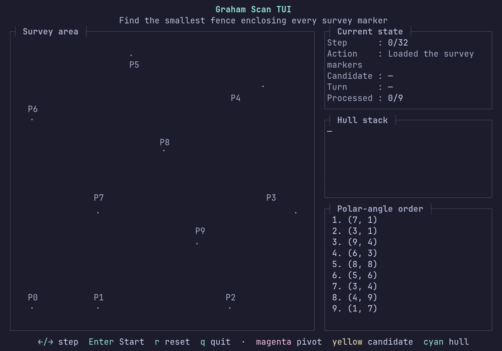

# Buggy Graham Scan



A minimal, deliberately buggy Graham scan based on
[matrohin/gav](https://github.com/matrohin/gav).

The program treats ten survey markers as points and tries to build the smallest
fence containing all of them. One boundary case is wrong: the final computed
fence cuts off an extreme marker.

## Run the visualization

```console
cargo run
```

Controls:

- `Left`/`Right` or `h`/`l`: move one algorithm step
- `Enter`: start, pause, or resume
- `r`: reset
- `q`: quit

## See also

See [Graham scan](https://en.wikipedia.org/wiki/Graham_scan) for the algorithm.
